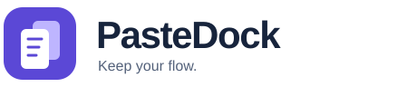
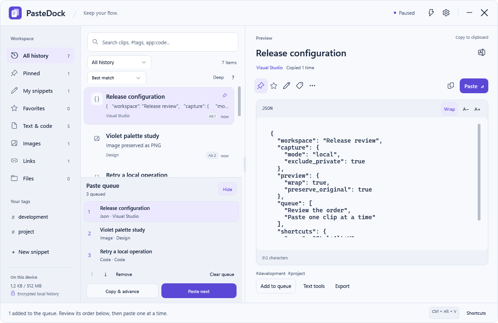
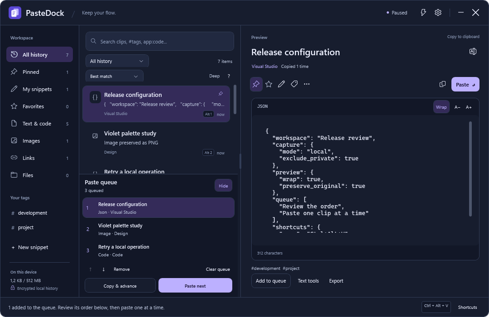
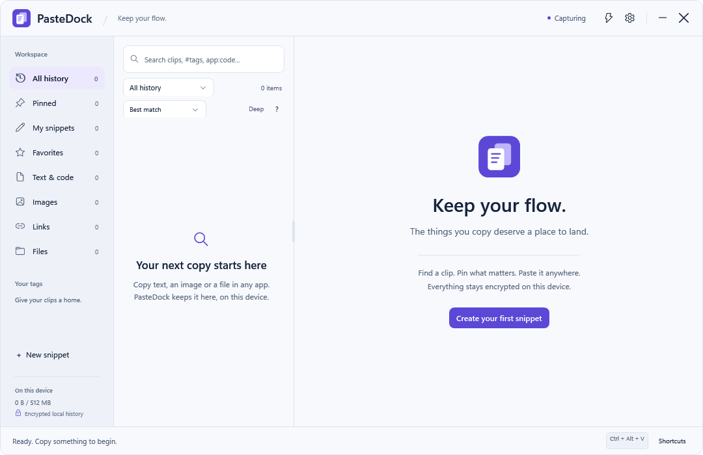

<p align="center"></p>
<p align="center"><a href="README.md"></a></p>
<h1 align="center">Ein Zuhause für alles, was du kopierst.</h1>
<p align="center">Wiederfinden. Bearbeiten. Weiterverwenden.<br>Dein lokaler Clipboard-Workspace für Windows.</p>
<p align="center">
  <a href="https://github.com/IamAngusU/PasteDock/releases/tag/v0.5.0"></a>
  <a href="#loslegen"></a>
  <a href="#deine-zwischenablage-bleibt-bei-dir"></a>
  <a href="docs/RELEASE-VALIDATION.md"></a>
</p>
<p align="center"><a href="https://github.com/IamAngusU/PasteDock/actions/workflows/windows.yml"></a></p>


<sub>Echtes Windows-Rendering mit synthetischen Beispielen. Die App-Oberfläche ist Englisch; die README gibt es auf Deutsch und Englisch.</sub>

## Neu in 0.5: ein besserer Arbeitsablauf

Mit **F2** gibst du Clips eigene Namen. Diese bleiben beim Bearbeiten, erneuten Kopieren und in verschlüsselten Backups erhalten. **My snippets** sammelt deine eigenen Notizen und schützt sie vor automatischer Retention.

Die **Paste-Queue** zeigt ihre Einträge und Reihenfolge. Du kannst umsortieren, einzelne Einträge entfernen oder mit **Copy & advance** bewusst kopieren und manuell einfügen. Fehlgeschlagene Kopien und unklare Paste-Ergebnisse lassen den Eintrag in der Queue.

Die Suche kann Wörter, Phrasen, Apps, Tags und Typen ausschließen. Dazu kommen fünf Sortierungen und direkt erreichbare Suchbeispiele. Deep prüft Ausschlüsse auch im vollständigen Inhalt. Filter bleiben in schmalen Fenstern bedienbar.

Fehler erscheinen mit vollständig lesbarer Rückmeldung. Ein geänderter Entwurf wird beim Abbrechen erst nach deiner ausdrücklichen Auswahl verworfen. Es gibt eine CSS-Farbvorschau, Textumbruch und Pfeiltasten im Befehlsmenü. Sortierung und Umbruch werden mit den Fensterpräferenzen gespeichert.

[Workflows und Suchbeispiele](docs/WORKFLOWS.md)
## Loslegen

1. **PasteDock-0.5.0-win-x64.zip** aus dem [Preview-Release](https://github.com/IamAngusU/PasteDock/releases/tag/v0.5.0) laden. Auf Windows-ARM-Geräten das ARM64-Archiv verwenden.
2. Den gesamten Ordner entpacken und **PasteDock.exe** starten. Die .NET-Runtime ist enthalten. Kein Admin, kein Konto.
3. In einer anderen App etwas kopieren. **Ctrl+Alt+V** öffnet PasteDock, **Enter** fügt ein. **Shift+Enter** fügt reinen Text ein.

Das Fenster zu schließen lässt die Erfassung im Tray weiterlaufen. **Quit PasteDock** im Tray beendet die App. Autostart ist in den Einstellungen optional. Die Preview ist nicht signiert; Windows kann einen Hinweis auf einen unbekannten Herausgeber anzeigen.

Technisches Minimum ist Windows 10 Version 2004. Verwende eine Windows-Version mit laufenden Sicherheitsupdates. x64 wurde lokal ausgeführt und geprüft. ARM64 wird kompiliert; eine native ARM64-Abnahme steht aus.

## Mehr aus Kopiertem machen

- Sofortsuche und vollständige Deep-Suche, Tags, App-/Typfilter, Datumsfilter und Kopierzähler.
- Pins, Favoriten, eigene Snippets, Inline-Bearbeitung und Deduplizierung.
- Originalformat oder Plain Text, App-Regeln, Mehrfachauswahl, Alt+1–9 und eine bewusst schrittweise Paste-Queue.
- JSON, Zeilenwerkzeuge, URL/Base64 und ein begrenzter Zwei-Clip-Diff. Originale bleiben erhalten.
- Bilder mit Zoom, Pan und Originalexport. Lokale Windows-OCR nur auf ausdrückliche Aktion und mit bereits installierten Sprachpaketen.
- Zehn Minuten verschlüsseltes Lösch-Undo sowie passwortgeschützte Backups. Ein Import verdrängt keine vorhandenen Clips.

<details><summary>Darkmode und erster Start</summary>




</details>

## Auch wenn etwas schiefgeht

Fehlende Quelldateien werden vor dem Ersetzen der Zwischenablage gemeldet. Ungültiges JSON verändert das Original nicht. Fehlerhafte Einstellungen bleiben korrigierbar. Ein Entwurf überlebt das Ausblenden. Gelöschte Queue-Einträge werden mit Erklärung übersprungen.

Vor automatischem Paste werden Zielprozess, Vordergrundfenster, Desktop, gehaltene Tasten und Clipboard-Sequenz erneut geprüft. Verhindert Windows das Einfügen, gibt es eine konkrete Rückmeldung. Unklare Paste-Vorgänge werden nicht automatisch wiederholt. [Ausgeführte Prüfungen und offene manuelle Abnahme](docs/RELEASE-VALIDATION.md).

## Deine Zwischenablage bleibt bei dir

Die Historie liegt mit Windows-DPAPI verschlüsselt unter `%LOCALAPPDATA%\PasteDock`. Keine Telemetrie, Konten, Cloud-Synchronisierung oder KI-Anfragen. Pause, Passwortmanager-Ausschlüsse, private Clipboard-Marker und bestmögliche Secret-Erkennung sind enthalten.

DPAPI schützt nicht gegen andere Programme unter demselben Windows-Benutzer. Secret-Erkennung erkennt nicht jedes Passwort. Dateieinträge sind Referenzen, keine Dateisicherung. Exporte und temporäre Paste-Dateien sind normale lokale Dateien. Backups verwenden ein eigenes Passwort. [Datenschutzmodell](docs/SECURITY.md).

Standard: 2.000 Clips, 30 Tage ungeschützte Historie, 512 MiB logisches Inhaltsbudget. Pins, Favoriten und eigene Snippets bleiben vor automatischer Retention geschützt. Maximal 64 MiB je Clip, 40 Millionen Bildpixel und 128 MiB Rohinhalte je Backup. [Ausführliche Funktionsreferenz](docs/USER-GUIDE.de.md).

## Entwicklung

```powershell
.\scripts\test.ps1
.\scripts\build.ps1 -Runtime win-x64
```

`global.json` legt das .NET-10-SDK fest. `build.cmd` kann ein hashgeprüftes Microsoft-SDK lokal im Projekt einrichten. Die App selbst benötigt keine Netzwerkverbindung und keine Runtime-NuGet-Pakete von Dritten.

[](https://github.com/IamAngusU/icon-marquee)

Repo-Auftritt in derselben Familie wie [ContextBridge](https://github.com/IamAngusU/ContextBridge) und [ByeClaude](https://github.com/IamAngusU/ByeClaude), generierte Badges und ein eigenständiger [Icon-Marquee](https://github.com/IamAngusU/icon-marquee)-Export. [Herkunft der Assets](docs/assets/README.md).

[MIT](LICENSE) · [Änderungen](CHANGELOG.md) · [Architektur](docs/ARCHITECTURE.md) · [Mitmachen](CONTRIBUTING.md) · [Security](SECURITY.md)
<p align="center"><sub>Von Angus Uelsmann · <a href="https://angusu.de">angusu.de</a></sub></p>
